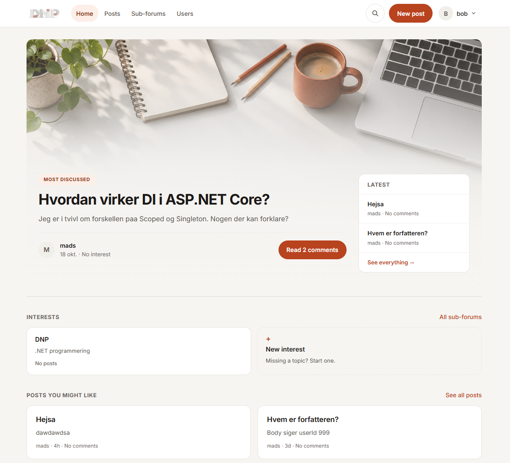

# DNP Assignment - ForumApp
2026-09-05 (opdateret 2026-11-08)

Dette repository indeholder en forum-applikation til kurset **DNP - .NET Programmering**. Projektet tager udgangspunkt i et Reddit-lignende forum, hvor brugere kan oprette posts, skrive kommentarer og organisere posts i subforums.

Applikationen er bygget op over flere assignments: domænemodel og repositories, en Command Line Interface, filbaseret persistence, en Web API, en Blazor-frontend, som brugerne kan betjene forummet fra, og login med JWT. Entity Framework Core er påbegyndt, men der er endnu ikke en database.

<a href="docs/screenshots/landing-page.png" target="_blank" rel="noopener">
  
</a>

Åbn de afsnit, du vil arbejde med. Al dokumentation er samlet her.

<details>
<summary><strong>Kom i gang</strong></summary>

Kræver .NET 10 SDK. Web API'en skal køre først, derefter Blazor-appen:

```
dotnet run --project Server/WebAPI --launch-profile http
dotnet run --project Client/Blazor-Application --launch-profile http
```

| | Adresse |
|---|---|
| Web API | `http://localhost:5028` |
| Swagger UI (Development) | `http://localhost:5028/swagger` |
| Blazor-frontend | `http://localhost:5050` |

API'et kan også startes med play-knappen i `WebAPI: http`. Filen `Server/WebAPI/WebAPI.http` indeholder eksempler på kald til alle endpoints, som kan køres direkte fra Rider eller VS Code. API'et starter uden data.

Adressen på API'et står i Blazor-appens `appsettings.json` under `WebApiBaseAddress`, så den kan ændres uden at kodes om.

</details>

<details>
<summary><strong>Projektets formål</strong></summary>

Formålet med denne assignment er at give den studerende (mig) et modulært .NET-projekt, samt får en forståelse af C# og forskellighederne mellem dét og Java. Derudover er hensigten også at vi får erfaringer med andre sprog og måder hvorpå de kan interagere med hinanden.

Strukturen gør det muligt at udskifte persistence-laget (in-memory, filer, senere Entity Framework Core med SQLite) uden at resten af applikationen behøver kende detaljerne. Det samme gælder mellem lagene i Web API'en: controllere kender kun service-interfaces, og services kender kun repository-interfaces. Dette støtter op om sidste semesters læring omkring dele af SOLID principperne.

</details>

<details>
<summary><strong>Domænemodel og relationer</strong></summary>

Domænemodellen viser de centrale entities i systemet og relationerne mellem dem.


Alle entities implementerer `IEntity`, som sikrer at de har et `Id` af typen `int`.

Projektet modellerer relationer med foreign keys i stedet for direkte associationer som `List<Comment>` eller `User Author`:

- En `Post` har en `UserId`, som peger på den bruger, der har skrevet opslaget.
- En `Post` har en `SubForumId`, som peger på det subforum, opslaget hører til. Feltet er valgfrit (`int?`), så en post kan eksistere uden subforum.
- En `Comment` har en `PostId`, som peger på det post, kommentaren hører til.
- En `Comment` har en `UserId`, som peger på den bruger, der har skrevet kommentaren.
- En `SubForum` har en `CreatorUserId`, som peger på brugeren, der oprettede subforummet.

Denne tilgang matcher den måde relationer senere kan gemmes i en relationel database.

</details>

<details>
<summary><strong>Løsningsstruktur</strong></summary>

```
DNP-Assignment-ForumAPP/
├── DNP-Assignment-ForumAPP.sln
├── ApiContracts/                DTO'er (og DeletedUser), som deles mellem server og klienter
│   ├── UserDTOs/
│   ├── PostDTOs/
│   ├── CommentDTOs/
│   └── SubForumDTOs/
├── Server/
│   ├── Entities/                Domæneklasser (User, Post, Comment, SubForum) og IEntity
│   ├── RepositoryContracts/     Interfaces for data-adgang
│   ├── InMemoryRepositories/    Repositories baseret på lister + DataSeeder
│   ├── FileRepository/          Repositories der gemmer data som JSON-filer
│   ├── EfcRepositories/         Entity Framework Core og AppContext (under opbygning)
│   ├── ServiceContracts/        Interfaces for services
│   ├── Services/                Forretningslogik, validering og mapping til DTO'er
│   ├── CLI/                     Command Line Interface (Assignment 2)
│   └── WebAPI/                  Controllere, Program.cs og WebAPI.http
├── Client/
│   └── Blazor-Application/      Blazor-frontend: Components/ (sider) og Services/ (HTTP-kald)
└── Tests/                       Unit tests og integration tests (xUnit + Moq)
```

</details>

<details>
<summary><strong>Repository-lag</strong></summary>

Repository-laget abstraherer data-adgang for hver entity. Hvert repository-interface definerer de samme grundlæggende CRUD-operationer:

- `AddAsync`
- `UpdateAsync`
- `DeleteAsync`
- `GetSingleAsync`
- `GetMany`

Der findes et repository-interface for hver entity: `IUserRepository`, `ISubForumRepository`, `IPostRepository` og `ICommentRepository`.

Et id bliver aldrig genbrugt, heller ikke selv om den nyeste entity er slettet. Det er vigtigt for en Web API, fordi id'er er en del af adresserne, klienter gemmer.

### In-memory repositories
De konkrete repository-implementationer ligger i projektet `InMemoryRepositories`. De gemmer data i en `List<T>` og er derfor kun midlertidige. Den fælles klasse `RepositoryBase<T>` indeholder den generelle CRUD-logik.

Dummy data findes i `DataSeeder.cs`, så der er brugere, subforums, posts og kommentarer at arbejde med fra starten.

### File repositories
Projektet `FileRepository` gemmer hver entity-type i sin egen JSON-fil i en `Data`-mappe (`users.json`, `posts.json`, `comments.json`, `subforums.json`). Den fælles klasse `FileRepositoryBase<T>` indeholder CRUD-logikken, så de fire konkrete repositories kun er en tynd klasse hver.

Ved siden af hver datafil ligger en lille `.nextid`-fil, som husker det næste ledige id. `Data`-mappen oprettes i den mappe, programmet startes fra, og den ligger i `.gitignore`, fordi den indeholder brugerdata.

</details>

<details>
<summary><strong>Web API</strong></summary>

Web API'en giver adgang til de samme funktioner som CLI'en, men over HTTP. Den følger REST-principperne: hver entity er en ressource med en adresse, og HTTP-verberne bestemmer handlingen.

### Statuskoder
| Kode | Bruges når |
|---|---|
| 200 OK | Læsning og opdatering lykkedes |
| 201 Created | En ressource blev oprettet (med `Location`-header) |
| 204 No Content | Sletning lykkedes |
| 400 Bad Request | Manglende eller ugyldigt input, en reference til en post/bruger/subforum der ikke findes, eller et brugernavn/en e-mail/et subforum-navn der allerede er i brug |
| 404 Not Found | Ressourcen findes ikke |

### PUT er en fuld erstatning
`PUT` erstatter hele ressourcen, så alle felter skal med i body. Det gælder også `subForumId` på en post: send et id, eller `null` for at fjerne posten fra subforummet. Udelades feltet, svarer API'et 400, så en post ikke tavst mister sit subforum.

### Ved sletning?
| Sletter man | Sker der |
|---|---|
| en post | Dens kommentarer slettes også |
| et subforum | Postene i subforummet beholdes, men får ingen subforum |
| en bruger | Brugerens posts, kommentarer og subforums beholdes. Forfatterens navn vises i stedet som `user no longer exists` |

En slettet brugers id bliver aldrig givet til en ny bruger, så indholdet kan ikke ende hos en anden. `PostDto.AuthorUserName`, `CommentDto.AuthorUserName` og `SubForumDto.CreatorUserName` får teksten fra `DeletedUser.UserName` i `ApiContracts`, så en klient kan genkende den og evt vise den i rød skrift.

Der er ikke tilføjet et transaktion-pattern over skriveoperationer. Går programmet ned midt i en sletning, kan en post være slettet uden at alle dens kommentarer er det.

### DTO'er
Entities sendes ikke direkte til klienterne. `ApiContracts` indeholder dedikerede DTO'er:

- `Create*Dto` og `Update*Dto` indeholder kun de felter, klienten selv skal udfylde. Id'et tildeles af serveren.
- `UserDto` indeholder ikke password.
- `PostDto`, `CommentDto` og `SubForumDto` indeholder forfatterens brugernavn, så klienten ikke selv skal slå det op.

### Lagdeling
Controllerne indeholder kun HTTP-delen: de tager imod request, kalder en service og oversætter resultatet til en statuskode. Services indeholder validering (påkrævede felter, unikke brugernavne og e-mails, at refererede entities findes) og mapper mellem entities og DTO'er. Alle afhængigheder registreres ét sted, i `Program.cs`, med dependency injection.

Opgaven beskriver forretningslogik i controlleren og et lag mere som en mulighed. Her er det lag med, så controllerne holdes tynde og servicerne kan unit-testes uden HTTP.

</details>

<details>
<summary><strong>Autentificering og ejerskab</strong></summary>

`POST /auth/login` validerer brugernavn og password og returnerer et JWT, signeret med HMAC-SHA256. Nøgle, issuer og audience står i `appsettings.json` under `Jwt`.

Endpoints markeret med `[Authorize]` kræver headeren `Authorization: Bearer <token>`. Mangler tokenet, eller er det ugyldigt eller udløbet, svarer API'et 401.

### Ejerskab
En bruger må kun ændre og slette sit eget indhold. Tjekket ligger i service-laget: entiteten hentes, og dens forfatter sammenlignes med `Id`-claimet fra tokenet. Passer de ikke, svarer API'et 403.

Brugere har et `Role`-felt, som sendes med som claim. En bruger med rollen `Admin` slipper forbi ejerskabstjekket og kan ændre alt. Nye brugere får rollen `User`, og rollen kan ikke sættes af klienten.

`[Authorize]` svarer på *hvem du er*; ejerskabstjekket svarer på *om indholdet er dit*. Policyen `MustBeAdmin` i `ApiContracts/Auth/AuthorizationPolicies.cs` deles mellem Web API'en og Blazor-frontenden.

### Passwords
Passwords gemmes i klartekst i feltet `User.Password`, præcis som de sendes ind. Hashing er ikke implementeret. `UserDto` indeholder ikke password, så det sendes aldrig tilbage til klienterne. Det samme gælder i CLI'en.

</details>

<details>
<summary><strong>Blazor frontend</strong></summary>

Frontenden er en **Blazor Web App** med interactive server rendering. Den har ingen adgang til repositories eller entities — al data hentes over HTTP fra Web API'en, og de DTO'er, der sendes frem og tilbage, er de samme fra `ApiContracts`.

### Sider
| Side | Adresse |
|---|---|
| Forside med fremhævet post og underfora | `/` |
| Søgning i posts eller brugere | `/search` |
| Log ind | `/login` |
| Opret bruger | `/users/create` |
| Liste over brugere | `/users` |
| Opret post | `/posts/create` |
| Liste over posts som kort med uddrag og kommentartæller | `/posts` |
| En post med body, forfatter og kommentarer, samt felt til ny kommentar | `/posts/{id}` |
| Opret subforum | `/subforums/create` |
| Liste over subforums | `/subforums` |

Listerne kan filtreres, og `/posts` kan desuden begrænses til ét subforum eller én forfatter via query-parametre. Søgesiden holder sin søgning i adressen: `/search?q=...&in=posts|users`. Underfora kaldes "Interests" i brugerfladen; i koden hedder de stadig subforum.

### Services
Mappen `Services` indeholder et interface og en `Http...`-implementation pr. entity, som registreres med dependency injection i `Program.cs`. Siderne kender kun interfacet.

Interfacene hedder `IPostApiService`, `ISubForumApiService`, `IUserApiService`, `ICommentApiService` og `IAuthApiService`. Endelsen `Api` adskiller dem fra serverens kontrakter i `ServiceContracts`, som før hed det samme.

De fire CRUD-kald er ens for alle entities, så de ligger i den generiske `HttpServiceBase<TDto, TCreate, TUpdate>`, der kender sin egen ressource-sti (`users`, `posts`, ...). Det er samme opbygning som service-kontrakterne på serveren og `IRepository<T>` i repository-laget. Hver konkret service er derfor kun en konstruktør plus sin egen filtrerings-metode.

Fejl fra API'et bliver kastet videre som en exception med serverens egen besked, og siderne viser beskeden i en rød boks i stedet for at crashe.

### Login
Brugeren logger ind på `/login`. Klienten kalder `POST /auth/login` og får et JWT tilbage, som gemmes i browseren med `ProtectedLocalStorage`, så det overlever en refresh.

`JwtAuthApiService` sætter tokenet på den `HttpClient`, alle fire services deler. Derfor sendes det automatisk med på alle kald til API'et. `CustomAuthProvider` oversætter tokenets claims til den `ClaimsPrincipal`, Blazor bruger i `<AuthorizeView>` og `[Authorize]`.

Forfatteren på en post, en kommentar eller et subforum tages fra `Id`-claimet i tokenet. Opret-siderne kræver login, og kommentarfeltet vises kun, når man er logget ind.

</details>

<details>
<summary><strong>Test</strong></summary>

Testprojektet bruger xUnit og Moq. Testene er delt i:

- **Unit tests** af repositories, services, DTO'er, DataSeeder og CLI-views (med fake repositories eller Moq).
- **Integration tests** af file repositories, DataSeeder og hele CLI'en (menuer, views og repositories sammen).

```
dotnet test Tests/Tests.csproj
```

</details>

<details>
<summary><strong>Teknologier</strong></summary>

- C#
- .NET
- ASP.NET Core Web API med controllere
- Blazor Web App (interactive server rendering) med `HttpClient`
- JWT til login (`Microsoft.AspNetCore.Authentication.JwtBearer`)
- Swagger (Swashbuckle) til dokumentation af API'et
- Class Library projects
- Asynkrone repository-metoder med `Task`
- `IQueryable<T>` til filtrering med LINQ
- JSON-filer som persistence
- xUnit og Moq

Projektfilerne bruger `net10.0` som target framework.

</details>

<details>
<summary><strong>Status</strong></summary>

Implementeret:

- Domæneklasser for `User`, `SubForum`, `Post` og `Comment`
- Repository contracts, in-memory repositories og dummydata i `DataSeeder`
- Filbaserede repositories (JSON)
- Command Line Interface
- Web API med controllere, service-lag og DTO'er
- Filtrering på liste-endpoints og nested routes for kommentarer og posts
- Blazor frontend med sider til brugere, posts, kommentarer og subforums
- Forside med fremhævet post, og søgeside på `/search`
- Login med JWT i både Web API og Blazor-frontend
- Ejerskab: kun forfatteren eller en admin kan ændre og slette
- Unit tests og integration tests
- `EfcRepositories` med NuGet-pakker og en `AppContext`

Ikke implementeret endnu:

- Navigation properties på entities — de bruger stadig kun fremmednøgler
- Migration og `app.db`
- De fire EFC-repositories, og at skifte `Program.cs` over til dem
- Hashing af passwords

</details>
