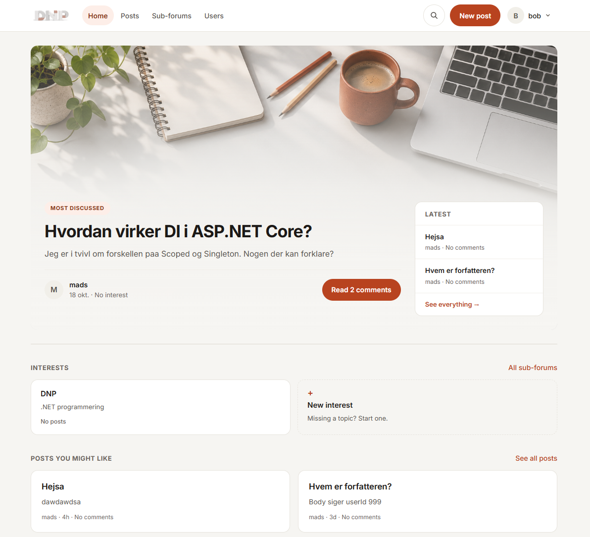
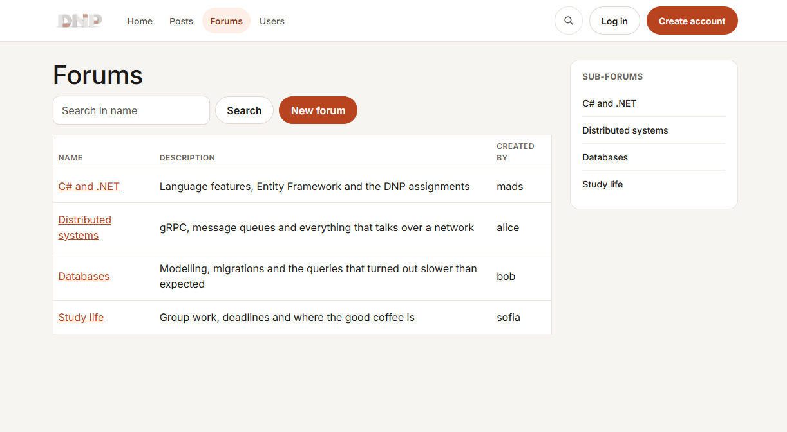
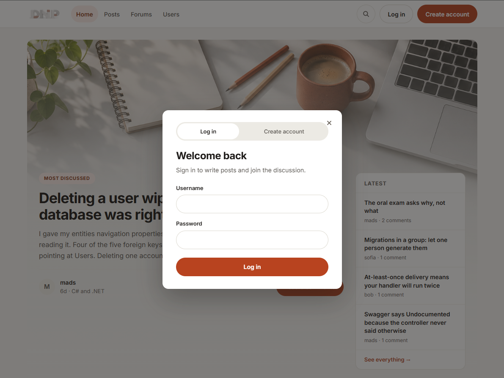
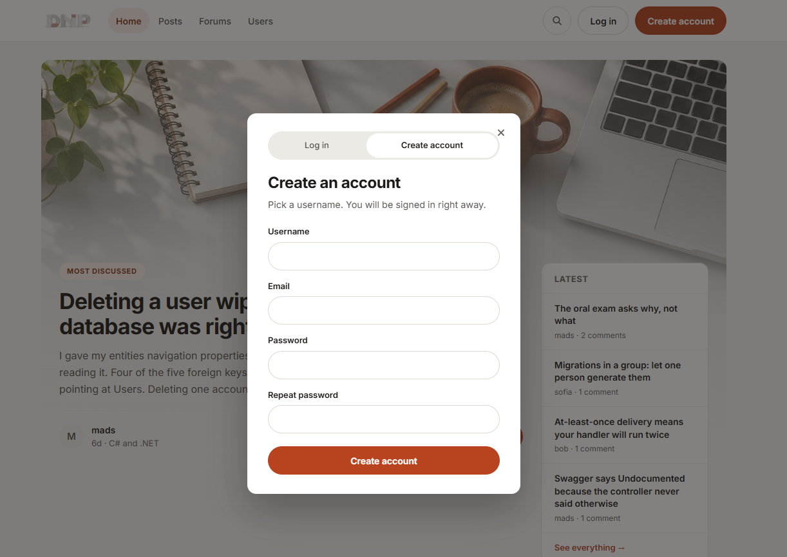
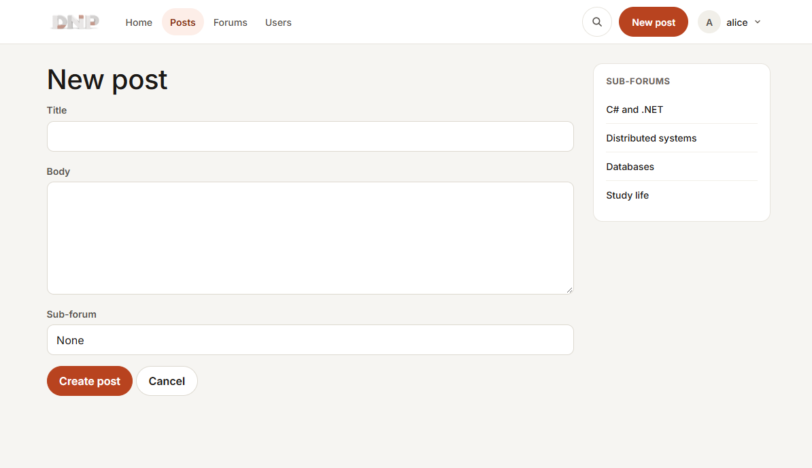
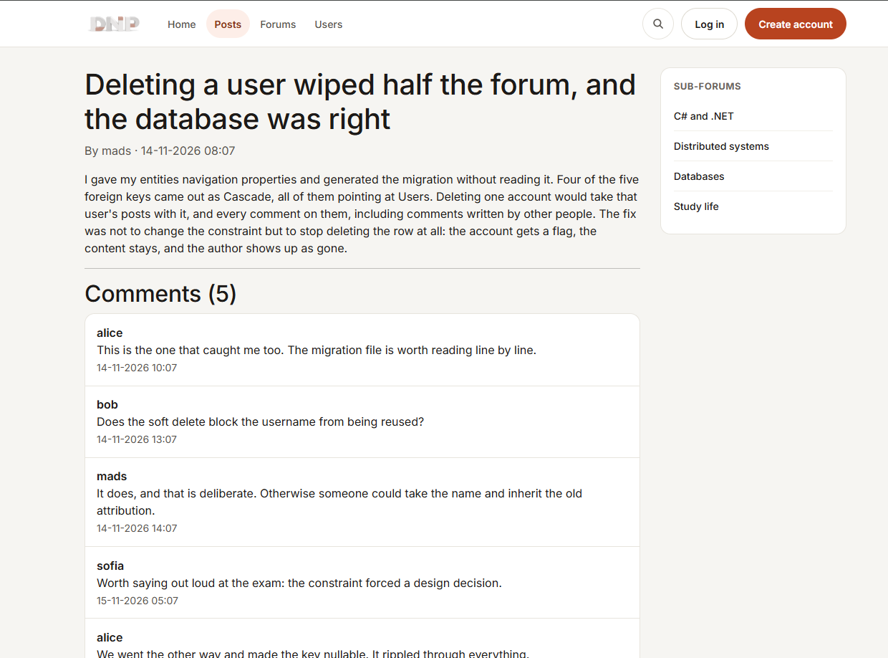
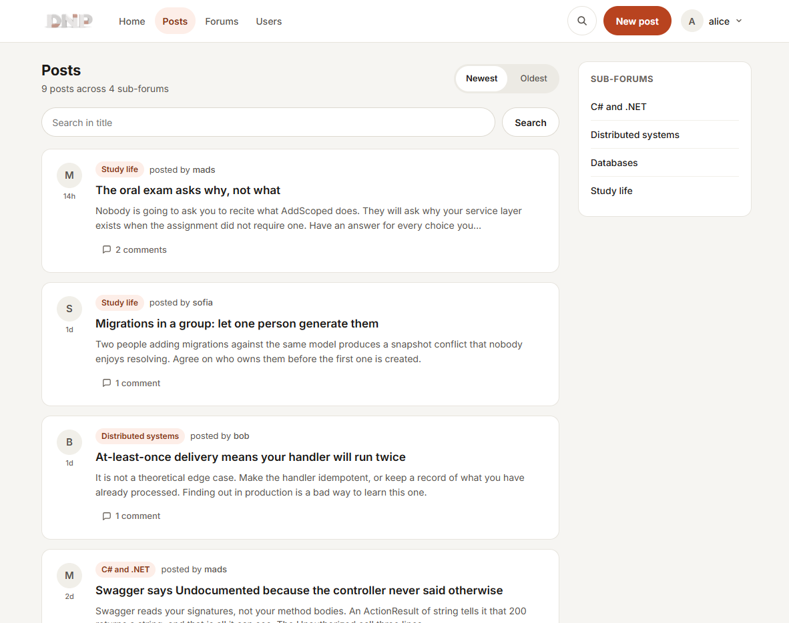
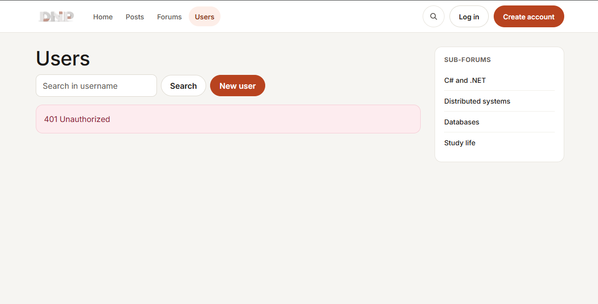
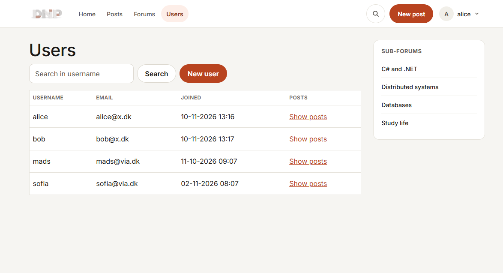

# DNP Assignment - ForumApp

2026-09-05 (opdateret 2026-11-20)

Studieprojekt i **DNP – .NET Programmering**: et Reddit-lignende forum med brugere, posts, kommentarer og subforums. Blazor-frontenden kommunikerer med en ASP.NET Core Web API, som gemmer data i SQLite gennem Entity Framework Core.

Herunder vises den færdige GUI og under dén findes yderligere informationer om projektet. Klik på et billede for at åbne det i fuld størrelse.

<table>
  <tr><th>Forside</th><th>Forum uden login</th><th>Log ind</th><th>Opret konto</th><th>Ny post</th></tr>
  <tr>
    <td><a href="docs/GUI/landing-page.png"></a></td>
    <td><a href="docs/GUI/Forum-not-logged-in.png"></a></td>
    <td><a href="docs/GUI/Log-in.png"></a></td>
    <td><a href="docs/GUI/Create-account.png"></a></td>
    <td><a href="docs/GUI/NewPost-logged-in.png"></a></td>
  </tr>
</table>

<br>

<table>
  <tr><th>Posts uden login</th><th>Posts med login</th><th>Posts fra en bruger</th><th>Brugere uden login</th><th>Brugere med login</th></tr>
  <tr>
    <td><a href="docs/GUI/Posts-not-logged-in.png"></a></td>
    <td><a href="docs/GUI/Posts-logged-in.png"></a></td>
    <td><a href="docs/GUI/Posts-by-user.%20-%20logged-in.png"></a></td>
    <td><a href="docs/GUI/Users-not-logged-in.png"></a></td>
    <td><a href="docs/GUI/Users-logged-in.png"></a></td>
  </tr>
</table>

<br>

Åbn de afsnit, du vil arbejde med. Dokumentation er samlet her.

<details>
<summary><strong>Funktioner og formål</strong></summary>

- Opret bruger, log ind, opret posts og tilføj kommentarer.
- Se og filtrér posts, brugere og subforums. Subforums kaldes **Interests** i GUI’en.
- Søg på posttitler eller brugernavne; brugersøgning kræver login.
- Slet posts som forfatter, admin eller opretter af postens subforum.
- Brug CLI’en til at oprette brugere, posts og kommentarer samt vise brugere og posts.
- Projektet demonstrerer C#, async/await, REST, dependency injection, DTO’er og persistens med lister, JSON og EFC.

</details>

<details>
<summary><strong>Kom i gang</strong></summary>

- Kræver **.NET 10 SDK** og EF-værktøjet: `dotnet tool install -g dotnet-ef --version "10.*"`.
- Kør kommandoerne fra mappen med `DNP-Assignment-ForumAPP.sln`.
- Databasen er ikke i git. Opret den fra migrationerne første gang:

```bash
cd Server/EfcRepositories
dotnet ef database update
cd ../..
```

Start API og frontend i **hver sin terminal**, begge fra projektroden:

```bash
dotnet run --project Server/WebAPI --launch-profile http
```

```bash
dotnet run --project Client/Blazor-Application --launch-profile http
```

| Del | Adresse |
| --- | --- |
| Web API | `http://localhost:5028` |
| Swagger UI i Development | `http://localhost:5028/swagger` |
| Blazor | `http://localhost:5050` |

- API’et kører `DemoDataSeeder`, når databasen ikke indeholder posts: fire brugere, fire interests, ni posts og kommentarer.
- Demobrugere: `mads` (Admin), `alice`, `bob` og `sofia` (User). Alle bruger password `demo1234`.
- Seedningen styres af, om der findes posts, og er ikke begrænset til Development.
- API-adressen ændres under `WebApiBaseAddress` i `Client/Blazor-Application/appsettings.json`.
- SQLite-stien i `Server/EfcRepositories/AppContext.cs` er relativ til arbejdsmappe. Ovenstående kommandoer bruger den forventede projektstruktur.

CLI kan køres separat og bruger JSON-filer frem for SQLite:

```bash
dotnet run --project Server/CLI
```

</details>

<details>
<summary><strong>Domænemodel og relationer</strong></summary>

Klik på modellen for at åbne den i fuld størrelse.

<a href="docs/diagrams/DNP-ForumAPP-DomainModel%20V2.svg"></a>

- Alle entities implementerer `IEntity` med et `int Id`.
- `User` kan skrive posts og kommentarer samt oprette subforums.
- `Post` har en forfatter og kan tilhøre et subforum. `SubForumId` er nullable.
- `Comment` tilhører én post og én bruger.
- Relationerne har foreign keys og navigation properties til EFC.
- Samlinger: `User.CreatedPosts/CreatedComments/CreatedSubForums`, `Post.CreatedComments` og `SubForum.CreatedPosts`.

</details>

<details>
<summary><strong>Projektstruktur og lagdeling</strong></summary>

```text
DNP-Assignment-ForumAPP/
├── ApiContracts/                DTO’er og fælles auth-policy
├── Server/
│   ├── Entities/                User, Post, Comment, SubForum og IEntity
│   ├── RepositoryContracts/     Interfaces til dataadgang
│   ├── InMemoryRepositories/    Listebaserede repositories og testdata
│   ├── FileRepository/          JSON-baserede repositories
│   ├── EfcRepositories/         DbContext, repositories og migrationer
│   ├── ServiceContracts/        Interfaces til forretningslogik
│   ├── Services/                Validering, ejerskab og DTO-mapping
│   ├── CLI/                     Konsolbrugerflade
│   └── WebAPI/                  Controllere, JWT og demo-seeding
├── Client/
│   └── Blazor-Application/      Razor-komponenter og HTTP-services
├── Tests/                       Unit- og integrationstests
└── docs/                        GUI-billeder og domænemodel
```

- Blazor kender DTO’er og kalder API’et gennem HTTP-services.
- Controllere håndterer HTTP og kalder service-interfaces.
- Services håndterer validering, ejerskab og mapping mellem entities og DTO’er.
- API’et bruger EFC-repositories; CLI’en bruger filrepositories direkte.
- Services bruger EFC-metoder som `ToListAsync` og `AnyAsync`. Et skift tilbage til fil- eller in-memory-repositories i API’et kræver derfor mere end ændret DI-registrering.

</details>

<details>
<summary><strong>Repositories og persistens</strong></summary>

- Alle repository-interfaces tilbyder `AddAsync`, `UpdateAsync`, `DeleteAsync`, `GetSingleAsync` og `GetMany`.
- Generiske baseklasser samler fælles CRUD-logik.
- **In-memory:** data i lister; `DataSeeder` bruges i tests.
- **Filer:** én JSON-fil pr. entity-type under `Data/` relativt til arbejdsmappe. En `.nextid`-fil forhindrer genbrug af slettede id’er.
- **EFC:** SQLite med `AppContext`, navigation properties og migrationen `initial`. Bruges af Web API’et.
- Lokale brugerdata og SQLite-databasen er ikke i git.

</details>

<details>
<summary><strong>Web API</strong></summary>

- CRUD-endpoints for `/users`, `/posts`, `/comments` og `/subforums`.
- Relationer: `GET /posts/{id}/comments` og `GET /subforums/{id}/posts`.
- Filtre: brugernavn; posttitel, forfatter og subforum; kommentarer på post og forfatter.
- Requests og svar bruger DTO’er fra `ApiContracts`. Password indgår ikke i svar.
- `PUT` kræver alle opdaterbare felter. For posts skal `subForumId` angives som et id eller `null`.
- [WebAPI.http](Server/WebAPI/WebAPI.http) indeholder et gennemgående forløb med login, id-/tokenvariabler og forventede fejlstatusser. Kør det med nye brugernavne, hvis eksemplets brugere allerede findes.

| Status | Betydning |
| --- | --- |
| 200 / 201 / 204 | Læst eller opdateret / oprettet / slettet |
| 400 | Ugyldigt input, reference eller optaget navn/e-mail |
| 401 / 403 | Manglende eller ugyldigt login / utilstrækkelig adgang |
| 404 | Ressourcen findes ikke |

| Sletning | Resultat |
| --- | --- |
| Post | Postens kommentarer slettes også. |
| Subforum | Posts bevares med `SubForumId = null`. |
| Bruger | Soft delete: indhold bevares, og forfatternavnet vises som `user no longer exists`. |

Sletninger med flere repository-kald er ikke samlet i én transaktion. En fejl kan derfor efterlade en delvist gennemført handling.

</details>

<details>
<summary><strong>Login og adgang</strong></summary>

- Login via navigationslinjens dialog eller `/login`; kontooprettelse findes også på `/users/create`.
- `POST /auth/login` returnerer et JWT signeret med HMAC-SHA256 og én times levetid.
- Klienten gemmer tokenet i `ProtectedLocalStorage` og sender det som `Authorization: Bearer <token>`.
- `CustomAuthProvider` leverer loginstatus til Blazor.
- Forfatter-id bestemmes af tokenet på serveren.
- Som udgangspunkt kan kun forfatteren ændre eller slette sit indhold. Admin kan også gøre det; subforumejeren kan desuden slette posts i eget subforum.
- Nye brugere får rollen User. Rollen kan ikke vælges i oprettelsesrequesten.
- Slettede brugere kan ikke logge ind, og deres eksisterende tokens afvises.

</details>

<details>
<summary><strong>Blazor sider</strong></summary>

| Side | Route |
| --- | --- |
| Forside | `/` |
| Søgning i posts eller brugere | `/search?q=...&in=posts` eller `in=users` |
| Login / opret bruger | `/login` / `/users/create` |
| Brugerliste | `/users` |
| Postliste / opret post | `/posts` / `/posts/create` |
| Post med kommentarer | `/posts/{id}` |
| Subforums / opret subforum | `/subforums` / `/subforums/create` |

- Postlisten kan filtreres på subforum og forfatter gennem query-parametre.
- Oprettelse af posts, subforums og kommentarer kræver login.
- API-fejl vises som beskeder i de relevante formularer og sider.

</details>

<details>
<summary><strong>Tests og kendte begrænsninger</strong></summary>

Kør fra projektroden:

```bash
dotnet test Tests/Tests.csproj
```

- **xUnit og Moq:** unit-tests af repositories, services, DTO’er, seeding og CLI-views.
- **Integration:** CLI-forløb, filpersistens, seeding, EFC-services mod isoleret SQLite og tokenvalidering ved kontosletning.
- Passwords gemmes i klartekst, og JWT-nøglen står i `appsettings.json`.
- Demo-seeding og faste demokonti er beregnet til demonstration; løsningen er ikke klar til offentlig drift.
- Blazor har endnu ikke redigeringssider eller fuld konto- og kommentaradministration.
- Lister har ingen serverpagination, og services har ingen samlet transaktion for sletninger på tværs af repositories.

</details>
